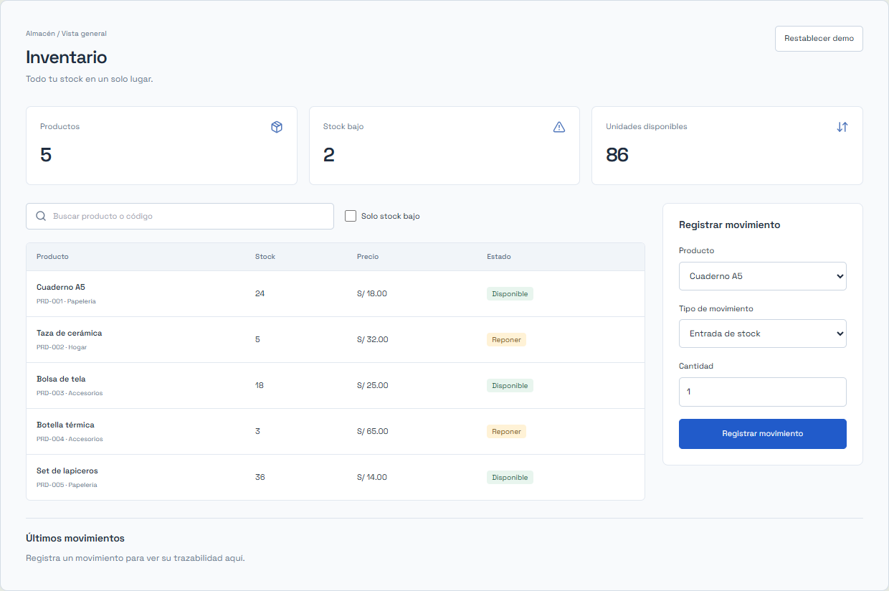
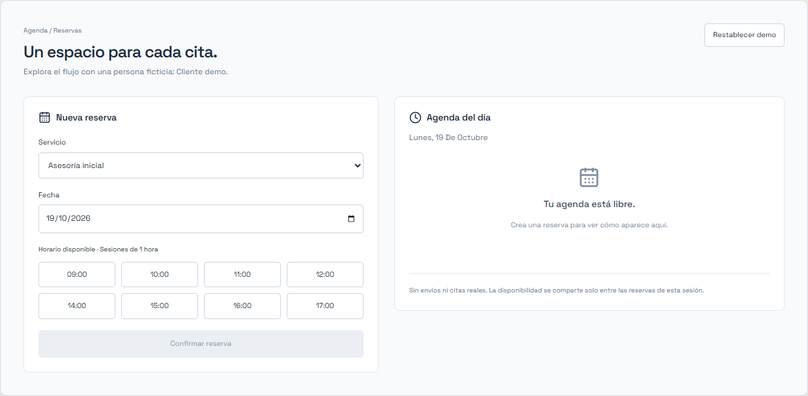
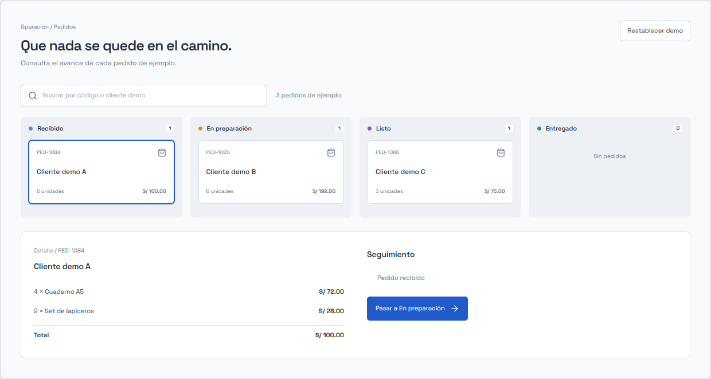

# Laboratorio PixelTech

Tres proyectos propios para demostrar decisiones de producto y desarrollo. No representan trabajos contratados, resultados ni datos de clientes. Todo funciona en el navegador, sin cuentas, pagos ni servicios externos.

## Ejecutar

Desde la raíz del repositorio:

```sh
npm install
npm run dev
```

Abrir `/proyectos/inventario/`, `/proyectos/reservas/` o `/proyectos/pedidos/` en el servidor indicado por Vite. Las rutas también funcionan directamente al publicar `dist/`.

## Inventario



**Problema:** consultar existencias y registrar movimientos sin depender de copias de hojas de cálculo.

**Flujo:** buscar por nombre o código, filtrar productos que requieren reposición, registrar entradas o salidas y consultar el historial. La salida se rechaza si supera el stock. Las cantidades deben ser enteros positivos.

**Código:** [InventoryDemo.jsx](InventoryDemo.jsx), [model.js](model.js).

**Decisiones:** saldo e historial se actualizan juntos. El catálogo es fijo para concentrar la demostración en movimientos y reposición. La alerta compara existencias con el mínimo de cada producto.

**Límites:** sin múltiples almacenes, facturación, lector de códigos, autenticación ni concurrencia entre usuarios.

## Reservas



**Problema:** registrar citas con una disponibilidad comprensible y evitar duplicar horarios.

**Flujo:** elegir servicio, fecha futura y horario; confirmar; consultar y cancelar. La cancelación libera el horario. Cambiar de servicio no permite reutilizar un horario reservado.

**Código:** [BookingDemo.jsx](BookingDemo.jsx), [model.js](model.js).

**Decisiones:** una agenda, sesiones de una hora, horarios predefinidos y fechas en la zona local del visitante. El cliente es ficticio para no solicitar datos personales. La fecha inicial es mañana; los horarios pasados se deshabilitan.

**Límites:** sin múltiples profesionales, recordatorios, pagos, calendario externo ni reservas reales. La producción requiere disponibilidad transaccional validada en el servidor.

## Pedidos



**Problema:** mantener el detalle y el avance de un pedido en una misma herramienta.

**Flujo:** buscar, seleccionar una tarjeta, revisar productos y total, avanzar de Recibido a En preparación, Listo y Entregado. Cada transición queda en el historial.

**Código:** [OrdersDemo.jsx](OrdersDemo.jsx), [model.js](model.js).

**Decisiones:** avance secuencial y estado final protegido; totales calculados a partir de los artículos; selección por identificador para conservar el contexto cuando cambia la columna.

**Límites:** sin creación de pedidos, facturación, pagos, notificaciones, login ni portal público de clientes. No permite retroceder estados ni gestionar devoluciones.

## Arquitectura y persistencia

- React para las vistas; funciones puras en `model.js` para las reglas de negocio.
- `useDemoState.js` guarda solo datos ficticios en `sessionStorage`, aislados por proyecto y versión. La lectura inválida o el almacenamiento bloqueado no impiden usar el estado inicial en memoria.
- “Restablecer demo” recupera el escenario original. No existe sincronización entre dispositivos o pestañas independientes.
- CSS de las demos separado del estilo retro de la consultoría: interfaz de producto actual dentro de una identidad de marca reconocible.
- La analítica transmite tipos de acción e identificadores de proyecto, sin contenidos de formularios.

## Validar y regenerar capturas

```sh
npm test
npm run build
npm run test:e2e
npm run dev -- --port 4173
```

En otra terminal: `npm run assets:previews`. El script requiere Chrome instalado y usa `http://127.0.0.1:4173`; se puede cambiar con `PREVIEW_URL`. Las imágenes son capturas del componente real, no imágenes conceptuales.

## Para llevar una demo a producción

Primero definir alcance, roles, datos e integraciones. Después agregar backend, autenticación, autorización, persistencia transaccional, validación en servidor, copias de seguridad, observabilidad y pruebas del flujo real. Estas demos no prometen esas capacidades.
